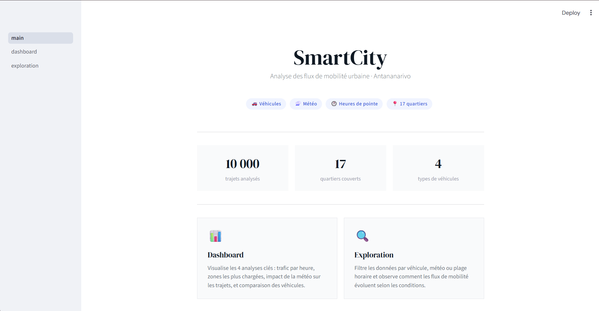
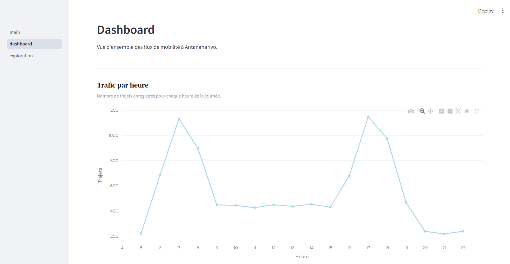
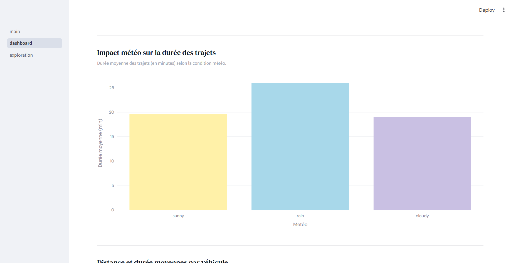
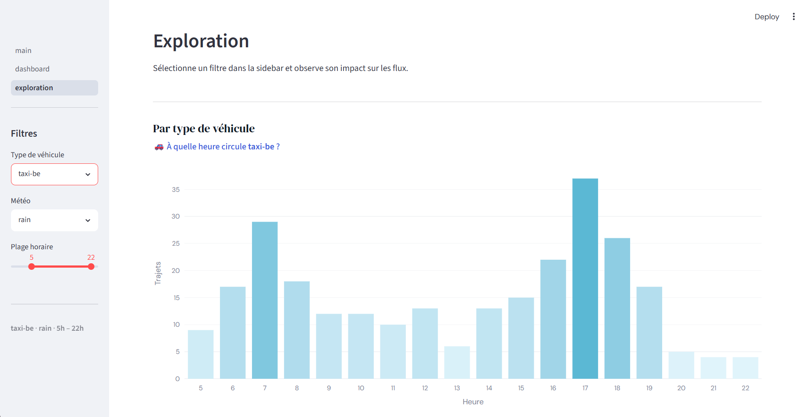
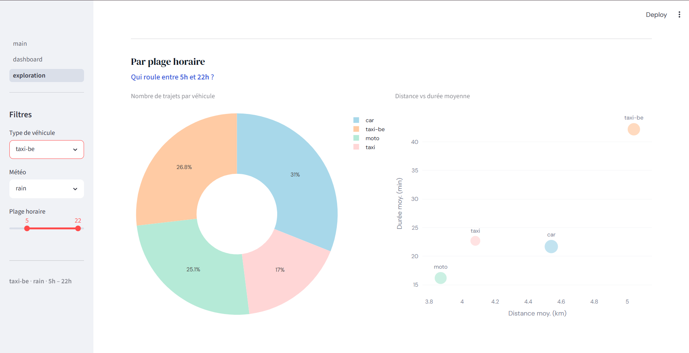

# Smart City Mobility Analytics — Antananarivo, Madagascar

An interactive urban mobility analytics platform built with **Python, Elasticsearch, and Streamlit**. This project explores simulated mobility patterns across 17 neighborhoods of Antananarivo, Madagascar, through data processing, Elasticsearch aggregations, and interactive visualizations.

## Application Overview

The application provides an interactive interface to explore urban mobility patterns, compare vehicle usage, and analyze the influence of weather conditions on simulated trips.



## Dashboard

The dashboard presents predefined analyses of the generated mobility dataset.

### Hourly Traffic Analysis

The dataset shows two main traffic peaks: **7:00 AM (1,132 trips)** and **5:00 PM (1,147 trips)**.



### Weather Impact on Trip Duration

Average trip duration is higher under rainy conditions (26 minutes) than under sunny (19.6 minutes) or cloudy conditions (19 minutes).



## Interactive Data Exploration

The exploration interface allows users to investigate specific mobility patterns using filters such as vehicle type, weather conditions, and time range.

### Taxi-be Hourly Traffic Analysis

With the selected filters (Taxi-be, rainy weather, 5:00 AM–10:00 PM), the analysis identifies two activity peaks: 7:00 AM (29 trips) and 5:00 PM (37 trips).



### Vehicle Distance and Duration Comparison

The comparison highlights differences in average trip distance and duration across vehicle types. Under the selected analysis conditions, Taxi-be trips have the highest average distance (5.01 km) and duration (42.2 minutes).



## Key Features

- Hourly traffic pattern analysis.
- Mobility analysis by neighborhood and vehicle type.
- Weather impact analysis on trip duration.
- Comparison of average trip distance and duration.
- Interactive filtering by vehicle type, weather, and time range.
- Elasticsearch queries and aggregations for data analysis.

## Technology Stack

- **Python** — data generation and processing
- **Elasticsearch 8.18** — data indexing and aggregations
- **Streamlit** — interactive web application
- **Pandas** — data manipulation
- **Plotly** — data visualization
- **Docker Compose** — Elasticsearch deployment

## Project Structure

```text
smart-city-mobility-analytics/
├── images/
│   ├── home.png
│   ├── dashboard/
│   │   ├── dashboard-traffic.png
│   │   └── dashboard-weather.png
│   └── exploration/
│       ├── exploration-taxi-be.png
│       └── exploration-vehicle-comparison.png
├── agregations/
├── app/
│   ├── main.py
│   └── pages/
├── data/
│   └── generate_data.py
├── elastic/
│   └── index.py
├── docs/
│   └── analysis.md
├── mobility_tana.csv
├── docker-compose.yml
├── requirements.txt
└── README.md
```

## Run Locally

### Prerequisites

- Python 3.10 or newer
- Docker Desktop with Docker Compose
- Git

### 1. Clone the repository

```bash
git clone https://github.com/malala1105/smart-city-mobility-analytics.git
cd smart-city-mobility-analytics
```

### 2. Create and activate a virtual environment

**Windows PowerShell:**

```powershell
python -m venv .venv
.venv\Scripts\Activate.ps1
```

**macOS / Linux:**

```bash
python3 -m venv .venv
source .venv/bin/activate
```

### 3. Install dependencies

```bash
pip install -r requirements.txt
```

### 4. Start Elasticsearch

```bash
docker compose up -d
```

Wait until Elasticsearch is available at `http://localhost:9200`.

### 5. Create the Elasticsearch index

```bash
python elastic/index.py
```

> **Warning:** This script deletes and recreates the existing `smart_city_mobility` index. Running it again will remove the documents currently stored in that index.

### 6. Generate and index the dataset

```bash
python data/generate_data.py
```

This generates 10,000 synthetic trips, indexes them in Elasticsearch, and exports the CSV dataset.

### 7. Launch the application

```bash
streamlit run app/main.py
```

Open the local URL displayed in the terminal, usually `http://localhost:8501`.

## Limitations

- All trips and mobility indicators are synthetically generated.
- Distances are estimated using neighborhood coordinates and a simplified road-distance factor, not actual GPS routes.
- Weather conditions, congestion levels, and vehicle distributions are simulated.
- The application requires a running Elasticsearch instance populated with the generated dataset.

## Author

**Iangotiana Noro Malala Andrianoelisoa**  
AI & Big Data Student | Aspiring Data Analyst & Data Scientist

*Academic portfolio project focused on urban mobility analytics in Antananarivo, Madagascar.*

---

For more detailed visualizations, numerical results, and analytical interpretations, see the [Full Analysis Report](docs/analysis.md).
