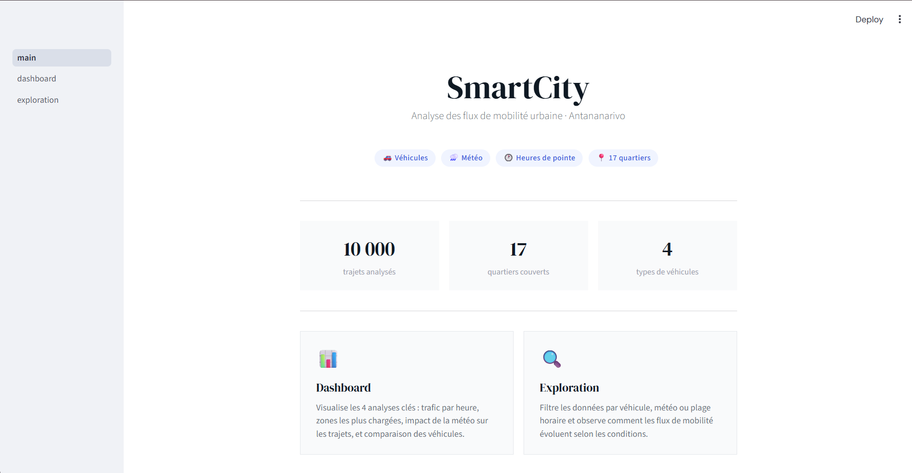
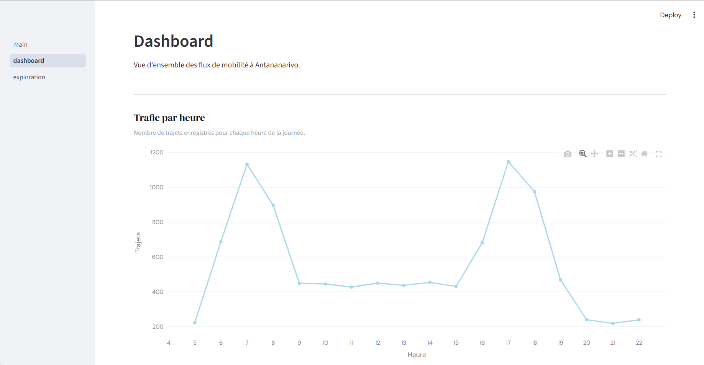
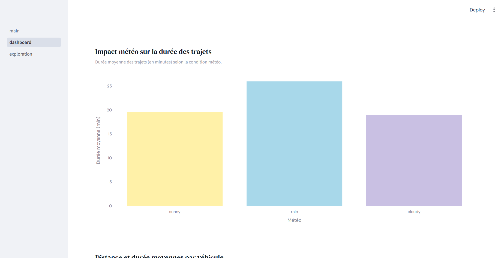
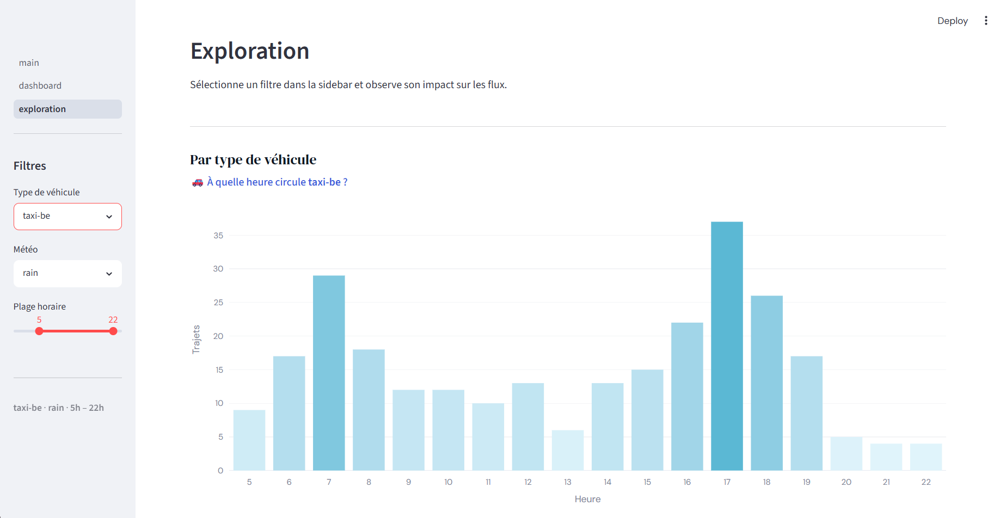
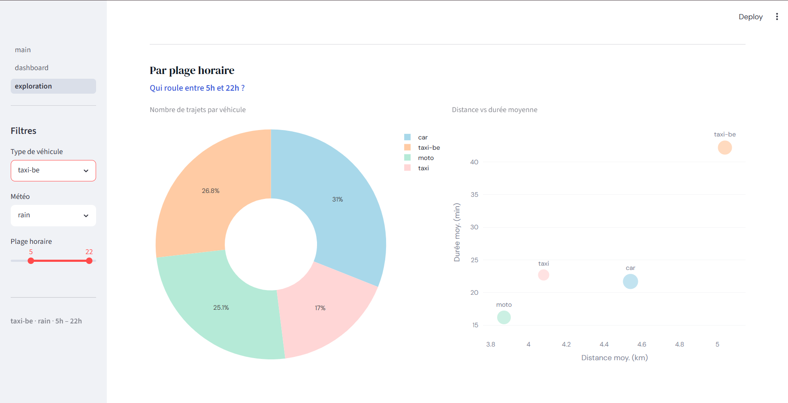

# Smart City Mobility Analytics — Detailed Analysis Report

## 1. Project Overview

Smart City Mobility Analytics is an interactive data analysis project focused on exploring urban mobility patterns in Antananarivo, Madagascar.

The application processes **10,000 synthetic trip records** covering 17 neighborhoods. It combines Python-based data processing, Elasticsearch queries and aggregations, and interactive Streamlit visualizations.

The main objective is to explore traffic patterns, understand differences in vehicle usage, and examine how weather conditions relate to trip duration.

### Application Home Page

The home page provides an overview of the application and serves as the entry point to the Dashboard and Interactive Exploration sections.

---

## 2. Dashboard Analysis

The Dashboard presents predefined analyses that provide an overview of the simulated mobility dataset.

### 2.1. Hourly Traffic Analysis

**Objective:** Identify the busiest hours of the day by examining the distribution of trips over time.

**Key Results:**

- Traffic activity increases between 5:00 AM and 8:00 AM.
- The first major peak occurs at **7:00 AM, with 1,132 trips**.
- A second increase appears between 4:00 PM and 6:00 PM.
- The highest recorded hourly volume occurs at **5:00 PM, with 1,147 trips**.
- Between 9:00 AM and 3:00 PM, the number of trips remains relatively stable and lower than during peak periods.

**Analysis and Interpretation:**

The distribution reveals two main periods of increased mobility: morning and late afternoon.

These patterns are consistent with a typical urban commuting structure, where travel activity increases around the beginning and end of the working day.

The evening peak is slightly higher than the morning peak, suggesting greater simulated trip activity around 5:00 PM.

**Key Insight:** The two main traffic peaks occur at 7:00 AM and 5:00 PM, identifying the busiest periods in the generated dataset.

### 2.2. Weather Impact on Trip Duration

**Objective:** Compare average trip duration under different weather conditions.

**Key Results:**

| Weather Condition | Average Trip Duration |
|---|---:|
| Sunny | 19.6 minutes |
| Rainy | 26 minutes |
| Cloudy | 19 minutes |

**Analysis and Interpretation:**

Rainy conditions are associated with the highest average trip duration, reaching **26 minutes**.

This represents an increase of approximately 33% compared with sunny conditions and 37% compared with cloudy conditions.

Sunny and cloudy conditions show relatively similar average durations, at 19.6 and 19 minutes respectively.

The results suggest an association between rainy weather and longer simulated trips. However, this analysis does not establish a causal relationship between weather and travel duration.

**Key Insight:** Trips recorded under rainy conditions have a higher average duration than those under sunny or cloudy conditions.

---

## 3. Interactive Data Exploration

The Interactive Exploration section allows users to investigate specific mobility patterns through dynamic filters.

For the two analyses presented below, the selected conditions were:

- **Vehicle type:** Taxi-be
- **Weather condition:** Rain
- **Time range:** 5:00 AM – 10:00 PM

### 3.1. Taxi-be Hourly Traffic Analysis

**Objective:** Examine the hourly distribution of Taxi-be trips under the selected weather and time conditions.

**Key Results:**

- The first activity peak occurs at **7:00 AM, with 29 trips**.
- The second and highest peak occurs at **5:00 PM, with 37 trips**.

**Analysis and Interpretation:**

The hourly distribution follows a pattern similar to the overall traffic analysis.

Taxi-be activity increases during the morning and late afternoon, with the highest number of trips recorded at 5:00 PM.

This suggests that, within the selected synthetic data subset, Taxi-be mobility is more concentrated around these two periods.

The comparison with the overall traffic distribution also highlights the presence of similar peak-hour patterns across different levels of analysis.

**Key Insight:** Taxi-be trips under the selected conditions are most frequent at 5:00 PM, followed by a morning peak at 7:00 AM.

### 3.2. Vehicle Distance and Duration Comparison

**Objective:** Compare average trip distance and duration across vehicle types to identify differences in mobility characteristics.

The visualization compares four vehicle categories: Taxi-be, car, taxi, and motorcycle.

**Key Results:**

| Vehicle Type | Average Distance | Average Duration | Number of Trips |
|---|---:|---:|---:|
| Taxi-be | 5.01 km | 42.2 min | 269 |
| Car | 4.54 km | 21.7 min | 311 |
| Taxi | 4.08 km | 22.7 min | 170 |
| Motorcycle | 3.87 km | 16.2 min | 252 |

**Total number of trips:** 1,002.

**Analysis and Interpretation:**

The comparison highlights several differences between vehicle categories:

- **Cars** have the highest number of trips, representing approximately 31% of the selected dataset.
- **Taxi-be** trips have the highest average distance (5.01 km) and average duration (42.2 minutes).
- **Motorcycles** have the shortest average distance (3.87 km) and duration (16.2 minutes).
- **Taxis** show intermediate values, with an average distance of 4.08 km and duration of 22.7 minutes.

The results indicate that vehicle categories differ in their average travel characteristics.

Taxi-be trips are longer in both distance and duration, while motorcycle trips are shorter on average.

Cars account for the largest share of trips, suggesting that they are the most frequently represented vehicle category in this dataset.

**Key Insight:** Cars have the highest trip volume, whereas Taxi-be trips have the greatest average distance and duration.

---

## 4. Overall Key Findings

The four selected visualizations reveal several important patterns in the generated mobility dataset:

1. **Peak-hour activity:** Overall traffic is highest at 7:00 AM and 5:00 PM.
2. **Weather and travel duration:** Rainy conditions are associated with longer average trip durations.
3. **Taxi-be mobility:** Under the selected filters, Taxi-be activity reaches its highest hourly volume at 5:00 PM.
4. **Vehicle comparison:** Cars account for the highest number of trips, while Taxi-be trips have the highest average distance and duration.

Together, these analyses demonstrate how data aggregation and interactive visualization can help identify mobility patterns and compare transportation characteristics.

---

## 5. Limitations

Several limitations must be considered when interpreting these results:

- **Synthetic dataset:** The 10,000 trip records are artificially generated and do not represent actual traffic measurements or official mobility records in Antananarivo.
- **Simulated conditions:** Weather, congestion, vehicle distributions, and trip characteristics are based on assumptions encoded in the data generation process.
- **Estimated distances:** Distances are calculated using neighborhood coordinates and a simplified road-distance factor rather than actual GPS routes.
- **No causal inference:** Observed differences between weather conditions and trip duration indicate associations within the generated dataset, not proven causal relationships.

Consequently, the findings should be interpreted as analytical demonstrations rather than conclusions about real-world urban mobility.

---

## 6. Conclusion

This project demonstrates an end-to-end data analytics workflow, from synthetic data generation and Elasticsearch indexing to data aggregation and interactive visualization.

The Dashboard provides an overview of mobility patterns, while the Interactive Exploration interface allows users to investigate specific subsets of the dataset and compare transportation characteristics.

Through this project, Python, Elasticsearch, Pandas, Plotly, and Streamlit were combined to build an interactive analytics application and transform structured trip records into interpretable visual insights.

The project also demonstrates practical skills in data preparation, querying, aggregation, exploratory data analysis, and data visualization.
